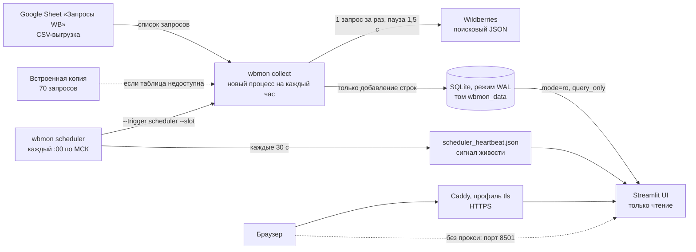

# WB SERP Monitor — мониторинг позиций в поиске Wildberries

Сервис раз в час собирает поисковую выдачу Wildberries по 70 запросам из Google-таблицы «Запросы WB»
(топ-200 товаров по каждому запросу, регион доставки — Москва), складывает **полную историю
наблюдений** в SQLite и показывает в веб-интерфейсе на Streamlit, как менялись позиции товаров.
Всё, что Wildberries не отдал, остаётся пустым: позиции и цены не достраиваются и не придумываются.

**Репозиторий:** https://github.com/U-Steph/wb-serp-monitor

**Работающий интерфейс:** https://194-226-98-141.sslip.io

Wildberries блокирует простые запросы и с сервера развёртывания, поэтому интерфейс показывает честную историю блокировок: сервис пробует каждый час и сохранит товары, как только Wildberries снова начнёт отвечать на обычные запросы.

**Описание для работодателя:** [SUBMISSION.md](SUBMISSION.md)

## Что это

Проект — тестовое задание: парсер поисковой выдачи Wildberries плюс веб-интерфейс с историей позиций.

- **Сбор.** Каждый час в :00 по Москве планировщик `wbmon scheduler` запускает новый процесс
  `wbmon collect`. Тот читает 70 запросов из Google-таблицы (если она недоступна — из встроенной копии),
  последовательно, с паузой 1,5 с между запросами, забирает до двухсот позиций на запрос и
  дописывает их в базу.
- **История.** Таблицы только дополняются: триггеры SQLite запрещают `UPDATE` и `DELETE` по
  наблюдениям. Каждая попытка по каждому запросу записана в журнал, включая неудачные.
- **Интерфейс.** Русскоязычный Streamlit только для чтения. Четыре вкладки: «📈 Позиции» (график
  позиций выбранных товаров во времени), «🗂 Выдача» (срез выдачи на момент сбора), «🩺 Журнал сборов»
  (статусы всех запросов по часам) и «ℹ️ О сервисе» (методика). Данные можно выгрузить в CSV.
- **Честность.** Если товара не было в полном топе, на графике разрыв линии. Если сбор не удался
  (блокировка, ошибка), этот час закрашен серой полосой: о товарах за него ничего не известно.

**С чего начать проверяющему.** Откройте вкладку «🩺 Журнал сборов»: там видно, что реально получилось
собрать и когда. Затем «📈 Позиции» — график и таблица характеристик. Если интерфейс показывает
заблокированные сборы, это не поломка: см. раздел «Проверка доступности Wildberries».

## Быстрый старт (Docker)

Нужны Docker и Docker Compose версии 2.24 или новее (необязательный файл `.env` читается синтаксисом,
который есть только в этих версиях). Три команды:

```bash
git clone https://github.com/U-Steph/wb-serp-monitor
cd wb-serp-monitor
docker compose up -d --build
```

Интерфейс откроется на http://localhost:8501. Поднимаются три сервиса: `init-db` (создаёт базу и
завершается), `collector` (планировщик) и `web` (Streamlit); база лежит в именованном томе
`wbmon_data`. Первый сбор начнётся сразу, если с начала текущего часа прошло не больше 45 минут
(догоняется только текущий час), иначе — в ближайшие :00 по Москве. Полный сбор занимает несколько
минут: 70 запросов по две страницы с паузой 1,5 с.

Если интерфейс нужен только на своём компьютере, привяжите порт к loopback:

```bash
WEB_BIND=127.0.0.1 docker compose up -d --build
```

То же, что первая команда, делает `make up`. Состояние и здоровье контейнеров показывает
`docker compose ps`, остановить стек без потери данных — `make down` (он выполняет `docker compose
down` без ключа удаления томов).

> **Не используйте `docker compose down -v`.** Ключ `-v` удаляет том `wbmon_data`, то есть всю
> накопленную историю. В примерах этого README его нет, и тест `tests/test_docs.py` следит за этим.

## Запуск без Docker

Нужен Python 3.11 или новее и GNU Make.

```bash
make install
make init-db
make collect-once
make scheduler
make web
```

- `make install` создаёт `.venv` и ставит проект с extras `dev` и `web`.
- `make init-db` создаёт или обновляет `data/wbmon.sqlite3` (повторный запуск безопасен).
- `make collect-once` — **один настоящий сбор**: он отправляет реальные запросы в Wildberries и в
  Google Sheets. Полный сбор — это 140 запросов и несколько минут.
- `make scheduler` держит планировщик на переднем плане: сбор каждый час в :00 по Москве.
- `make web` запускает интерфейс на http://localhost:8501 (в другом терминале, пока работает сбор).

Настройки `make` берёт из необязательного файла `.env` (см. «Конфигурация»). То же без `make`:

```bash
.venv/bin/wbmon init-db
.venv/bin/wbmon collect --limit-queries 2 --top-n 20
.venv/bin/wbmon scheduler
.venv/bin/wbmon healthcheck
.venv/bin/streamlit run src/wbmon/ui/app.py
python -m wbmon --help
```

`--limit-queries 2 --top-n 20` — быстрая проверка на двух первых запросах (тоже реальные запросы,
но их десяток). Для разовой настройки без `.env` переменные можно поставить перед командой:

```bash
WBMON_TOP_N=20 .venv/bin/wbmon collect --limit-queries 2
```

Команда `wbmon probe` отправляет **ровно один** запрос первой страницы без повторов, печатает одну
JSON-строку с исходом и **ничего не записывает** в базу:

```bash
.venv/bin/wbmon probe
.venv/bin/wbmon probe --query "постельное белье евро"
```

Коды выхода: 0 — успех (у `collect` также 0, если все запросы были заблокированы, если уже идёт другой
сбор или если запись за этот час уже есть), 2 — ошибка аргументов или конфигурации (в сообщении названа
переменная), 1 — сбой. `wbmon healthcheck` возвращает только 0 или 1.

## Развёртывание на сервере

Вариантов два: Docker Compose (основной) и systemd без Docker. Streamlit Community Cloud не подходит:
у него нет общего с коллектором файла SQLite, а приложение «засыпает» без трафика.

### Вариант A. Docker Compose на VPS

```bash
git clone https://github.com/U-Steph/wb-serp-monitor
cd wb-serp-monitor
docker compose build
docker compose run --rm --no-deps collector wbmon probe
docker compose up -d
docker compose ps
```

1. **Сначала проба.** `wbmon probe` с этого сервера показывает, пропускает ли Wildberries запросы
   оттуда (см. «Проверка доступности Wildberries»). Он ничего не пишет в базу. Если исход
   `blocked`, сервис всё равно можно запускать: он честно запишет блокировки в историю, но данных
   о позициях при этом не будет.
2. **Публичная ссылка** по умолчанию — `http://IP-СЕРВЕРА:8501`: `WEB_BIND=0.0.0.0` публикует Streamlit
   на всех интерфейсах (в интерфейсе нет авторизации, он только читает базу). Docker обходит ufw и
   firewalld, поэтому закрывать порт нужно настройкой самого стека, а не файрвола хоста.
3. **HTTPS** даёт Caddy (профиль `tls`) с автоматическим сертификатом Let's Encrypt. Нужен домен,
   указывающий на сервер, или имя вида `203-0-113-5.sslip.io` (IP через дефисы) и открытые порты 80 и 443.
   `make up-tls` запускает стек с `COMPOSE_PROFILES=tls` и `WEB_BIND=127.0.0.1`, чтобы открытый порт
   8501 не остался рядом с HTTPS:

   ```bash
   SITE_ADDRESS=203-0-113-5.sslip.io make up-tls
   ```

   Без `make`: `WEB_BIND=127.0.0.1 docker compose --profile tls up -d --build` и `SITE_ADDRESS` в окружении
   или в `.env`. Одного `--profile tls` без `WEB_BIND=127.0.0.1` мало: порт 8501 останется публичным.
4. **Хосты без Docker Hub или PyPI.** Образы `PYTHON_IMAGE`, `CADDY_IMAGE` и индекс `PIP_INDEX_URL`
   можно заменить зеркалами (какому зеркалу доверять, решает оператор; в `PIP_INDEX_URL` не кладите
   логин и пароль — аргумент сборки виден в `docker history`):

   ```bash
   PYTHON_IMAGE=mirror.example.com/python:3.12-slim PIP_INDEX_URL=https://mirror.example.com/simple docker compose build
   ```

   Либо соберите образ на машине с доступом к реестрам, перенесите его и запустите без сборки:

   ```bash
   docker save -o wb-serp-monitor.tar wb-serp-monitor:local
   docker load -i wb-serp-monitor.tar
   make up-prebuilt
   ```

   Для режима `tls` аналогично перенесите образ `caddy:2.11-alpine`.

### Вариант B. systemd без Docker

Те же программы, что в контейнерах, но запущенные как службы systemd. Юниты лежат в репозитории:
`deploy/systemd/wbmon-scheduler.service` (планировщик, команда `wbmon scheduler --db ...`) и
`deploy/systemd/wbmon-web.service` (Streamlit с теми же флагами, что в `compose.yaml`). Они работают от
системного пользователя `wbserp` (назван иначе, чем команда `wbmon`, намеренно), с `Restart=always` и
ограничениями systemd: `NoNewPrivileges`, `ProtectSystem=strict`, `ProtectHome`, `PrivateTmp`. Писать они
могут только в `/var/lib/wbmon` — там лежат база, блокировка и сигнал живости. Окно остановки
планировщика (150 с) равно `stop_grace_period` коллектора в Compose: SIGTERM получает только планировщик
(`KillMode=mixed`), передаёт его сборщику, и тот честно закрывает текущий сбор.

```bash
sudo useradd --system --home-dir /var/lib/wbmon --shell /usr/sbin/nologin wbserp
sudo git clone https://github.com/U-Steph/wb-serp-monitor /opt/wb-serp-monitor
sudo python3 -m venv /opt/wb-serp-monitor/.venv
sudo /opt/wb-serp-monitor/.venv/bin/pip install "/opt/wb-serp-monitor[web]"
sudo -u wbserp /opt/wb-serp-monitor/.venv/bin/wbmon probe
sudo cp /opt/wb-serp-monitor/deploy/systemd/wbmon-scheduler.service /etc/systemd/system/
sudo cp /opt/wb-serp-monitor/deploy/systemd/wbmon-web.service /etc/systemd/system/
sudo systemctl daemon-reload
sudo systemctl enable --now wbmon-scheduler wbmon-web
sudo systemctl status wbmon-scheduler wbmon-web --no-pager
```

- Нужен Python 3.11 или новее. Пробу (`probe`) смотрите до `enable --now`, как и в варианте A.
- Необязательные переопределения `WBMON_*` кладут в `/etc/default/wbmon` строками `KEY=value` (без
  `export`); путь к базе в юните задан флагом `--db` и от этого файла не зависит.
- Чтобы спрятать Streamlit за обратным прокси, привяжите его к `127.0.0.1`: `sudo systemctl edit
  wbmon-web` и новый `ExecStart` (пример — в комментарии в начале юнита).
- Обновление: `sudo git -C /opt/wb-serp-monitor pull`, повторный `pip install` из команд выше и
  `sudo systemctl restart wbmon-scheduler wbmon-web`.

## Конфигурация

Все настройки необязательны: без единого файла `.env` сервис работает на значениях по умолчанию.
Пустое значение переменной считается незаданным. Неверное значение останавливает программу с кодом 2 и
сообщением, в котором названа переменная. Файл `.env.example` в репозиторий не входит: полный список
с умолчаниями — таблица ниже и готовый блок `dotenv` под ней. Скопируйте нужные строки в `.env`
в корне репозитория (его читают Docker Compose и `make`).

| Переменная | По умолчанию | Где действует | Назначение |
|---|---|---|---|
| `WBMON_DB_PATH` | `data/wbmon.sqlite3` | коллектор, интерфейс | Путь к базе SQLite. В Docker всегда `/data/wbmon.sqlite3` (закреплён в `compose.yaml`, `.env` его не сдвинет), в systemd — флаг `--db`. |
| `WBMON_TOP_N` | `200` | коллектор | Сколько позиций собирать по запросу, от 1 до 1000. |
| `WBMON_DEST` | `-1257786` | коллектор | Параметр `dest` Wildberries: регион доставки (Москва). Допущение, см. «Поля и допущения». |
| `WBMON_SEARCH_URL` | `https://search.wb.ru/exactmatch/ru/common/v18/search` | коллектор | Адрес поискового JSON; должен быть http(s) с хостом. |
| `WBMON_REQUEST_DELAY` | `1.5` | коллектор | Пауза между последовательными запросами, секунды; минимум 0,5. Фиксированная, без случайного разброса. |
| `WBMON_RUN_DEADLINE` | `2400` | коллектор | Предельная длительность сбора, секунды: оставшиеся запросы записываются как `error` / `deadline`. |
| `WBMON_SHEET_CSV_URL` | `https://docs.google.com/spreadsheets/d/1K0m4229w_1LONgrNzWpx8lkkDcAlbdZH5ifHenZV3x8/export?format=csv` | коллектор | CSV-выгрузка Google-таблицы «Запросы WB» (идентификатор таблицы `1K0m4229w_1LONgrNzWpx8lkkDcAlbdZH5ifHenZV3x8`). |
| `WBMON_USER_AGENT` | `Mozilla/5.0 (compatible; wbmon/0.1.0; +https://github.com/U-Steph/wb-serp-monitor)` | коллектор | Честный User-Agent с версией и ссылкой на репозиторий; одна непустая строка. |
| `WBMON_TIMEZONE` | `Europe/Moscow` | коллектор | Часовой пояс для расчёта дней доставки. Расписание от него не зависит: сборы идут в :00 по Москве (UTC+3). |
| `WBMON_LOG_LEVEL` | `INFO` | все процессы | Уровень журнала: `DEBUG`, `INFO`, `WARNING` или `ERROR`. |
| `WEB_BIND` | `0.0.0.0` | Compose | Адрес, на котором Docker публикует порт интерфейса. `127.0.0.1` — только с этой машины (обязательно с профилем `tls`). |
| `WEB_PORT` | `8501` | Compose | Порт интерфейса на хосте. |
| `SITE_ADDRESS` | `:80` | Compose, Caddy | Адрес сайта для Caddy: домен, `IP-через-дефисы.sslip.io` или `:80` (обычный HTTP). |
| `COMPOSE_PROFILES` | пусто | Compose | `tls` включает Caddy. Включайте вместе с `WEB_BIND=127.0.0.1` или командой `make up-tls`. |
| `PYTHON_IMAGE` | `python:3.12-slim` | сборка образа | Базовый образ (зеркало для хостов без Docker Hub). |
| `CADDY_IMAGE` | `caddy:2.11-alpine` | Compose, Caddy | Образ обратного прокси. |
| `PIP_INDEX_URL` | `https://pypi.org/simple` | сборка образа | Индекс пакетов (зеркало для хостов без PyPI), без логина и пароля. |

Готовый блок для `.env`: все переменные закомментированы значениями по умолчанию, раскомментируйте
нужные. Значение с пробелами и скобками заключено в одинарные кавычки: так файл читают и Compose, и
`make` (он подключает `.env` через оболочку bash).

```dotenv
# WBMON_DB_PATH=data/wbmon.sqlite3
# WBMON_TOP_N=200
# WBMON_DEST=-1257786
# WBMON_SEARCH_URL=https://search.wb.ru/exactmatch/ru/common/v18/search
# WBMON_REQUEST_DELAY=1.5
# WBMON_RUN_DEADLINE=2400
# WBMON_SHEET_CSV_URL=https://docs.google.com/spreadsheets/d/1K0m4229w_1LONgrNzWpx8lkkDcAlbdZH5ifHenZV3x8/export?format=csv
# WBMON_USER_AGENT='Mozilla/5.0 (compatible; wbmon/0.1.0; +https://github.com/U-Steph/wb-serp-monitor)'
# WBMON_TIMEZONE=Europe/Moscow
# WBMON_LOG_LEVEL=INFO
# WEB_BIND=0.0.0.0
# WEB_PORT=8501
# SITE_ADDRESS=:80
# COMPOSE_PROFILES=
# PYTHON_IMAGE=python:3.12-slim
# CADDY_IMAGE=caddy:2.11-alpine
# PIP_INDEX_URL=https://pypi.org/simple
```

Параметры запроса к Wildberries, которые не настраиваются: `ab_testing=false`, `appType=1`, `curr=rub`,
`lang=ru`, `locale=ru`, `resultset=catalog`, `sort=popular`, `spp=30`, `suppressSpellcheck=false`, а
также `dest`, `page` и `query`. Текст запроса передаётся байт в байт: без `strip`, без смены
регистра, без нормализации Unicode (`ё`, опечатка «2-спальный» и кириллическая «х» против латинской
«x» остаются как в таблице). Заголовки: `Accept: application/json`, `Accept-Language: ru-RU,ru;q=0.9`,
честный `User-Agent`; куки не хранятся, прокси не используются, редиректы не выполняются.

## Архитектура



Карта модулей `src/wbmon/`:

| Модуль | Назначение |
|---|---|
| `src/wbmon/cli.py`, `src/wbmon/__main__.py` | Команды `init-db`, `collect`, `probe`, `scheduler`, `healthcheck`; коды выхода. |
| `src/wbmon/config.py` | Неизменяемые настройки из `WBMON_*` с проверкой значений. |
| `src/wbmon/queries.py` | Список запросов: Google-таблица, встроенная копия `src/wbmon/data/queries_bundled.txt`. |
| `src/wbmon/wb_client.py` | HTTP-клиент: честный User-Agent, пауза, ограниченные повторы, `Retry-After`. |
| `src/wbmon/classify.py` | Классификация ответа до разбора: `ok`, `blocked`, `rate_limited`, `error`. |
| `src/wbmon/pager.py`, `src/wbmon/collector.py` | Постраничный сбор топ-N одного запроса; позиции сквозные, дубли оставляют разрыв. |
| `src/wbmon/normalize.py`, `src/wbmon/delivery.py` | Приведение карточки к строке наблюдения; расчёт дней доставки. Неизвестное остаётся `NULL`. |
| `src/wbmon/orchestrator.py` | Один сбор целиком: блокировка, слот, предохранитель, дедлайн, изоляция запросов. |
| `src/wbmon/scheduler.py`, `src/wbmon/schedule.py`, `src/wbmon/signals.py` | Почасовой цикл, арифметика слотов, обработка SIGTERM. |
| `src/wbmon/health.py` | Файл сигнала живости и проверка `wbmon healthcheck`. |
| `src/wbmon/storage/` | Схема и миграции, запись (`writer.py`), чтение (`reader.py`), соединения (`db.py`), блокировка (`lock.py`). |
| `src/wbmon/ui/` | Streamlit-приложение: `app.py`, слой данных `data.py`, логика рядов `series.py`, графики `charts.py`, тексты `texts.py`. |

Как сбор остаётся безопасным без присмотра:

- **Темп.** Запросы идут строго по очереди с фиксированной паузой `WBMON_REQUEST_DELAY` (1,5 с):
  около 140 запросов в час.
- **Предохранитель.** После 3 подряд заблокированных или ограниченных по частоте запросов остальные
  записываются как `blocked` / `circuit_open` без обращения к сети, чтобы не нагружать Wildberries повторными запросами.
- **Дедлайн.** Сбор не длится дольше `WBMON_RUN_DEADLINE` секунд; остаток помечается `error` / `deadline`.
- **Без наложений.** Файл-блокировка `{db}.lock` и `UNIQUE`-слот часа делают двойной сбор невозможным;
  запись за уже собранный час пропускается с кодом 0. Прошлые часы никогда не «добираются».
- **Живость.** Планировщик минимум раз в 30 секунд обновляет `scheduler_heartbeat.json` рядом с базой;
  `wbmon healthcheck` проверяет его возраст, а интерфейс показывает строку о сборщике.
- **Остановка.** SIGTERM планировщик передаёт сборщику; тот дожидается запроса, который уже идёт, и
  закрывает сбор честно (оставшиеся запросы — `error` / `terminated`).
- **Сбой.** Упавший сбор остаётся в журнале и при следующем старте получает статус `abandoned`.

## Модель данных

База — один файл SQLite в режиме WAL (один писатель — коллектор, читатели — интерфейс и операторы).
Версия схемы хранится в `PRAGMA user_version`; `wbmon init-db` применяет миграции идемпотентно. Время
хранится в UTC в виде `2026-10-16T09:00:00Z`, на экране показывается московское.

| Таблица | Строка — это | Ключевые колонки |
|---|---|---|
| `queries` | Поисковый запрос | `text` (уникален, неизменяем), `sheet_order`, `first_seen_at`, `last_seen_at` |
| `runs` | Один сбор | `slot_utc` (уникален), `trigger` (`manual`, `scheduler`), `started_at`, `finished_at`, `status`, `query_source` (`sheet` или `bundled`), `params_json` (эндпоинт, параметры, `dest`, `top_n`, пауза, User-Agent), счётчики по статусам |
| `run_queries` | Попытка по запросу в сборе | `status`, `error_class`, `http_status`, `pages_fetched`, `items_collected`, `is_complete`, `normquery`, `ad_slot_mismatch`, `duplicates_dropped`, `error_message`; `UNIQUE (run_id, query_id)` |
| `observations` | Товар на позиции в выдаче | `collected_at`, `position`, `nm_id`, название, бренд, цены, рейтинг, отзывы, доставка, продавец, рекламные поля; `UNIQUE (run_id, query_id, position)` |

- **Только добавление.** Триггеры запрещают `UPDATE` и `DELETE` в `observations` и `run_queries`,
  удаление из `runs` и `queries`, правку текста запроса и изменение завершённого сбора. Менять можно
  только сбор в статусе `running`, пока он идёт.
- **Одна транзакция на запрос.** Наблюдения запроса и его строка в `run_queries` пишутся вместе
  (`BEGIN IMMEDIATE`), поэтому сбой одного запроса не оставляет полузаписанных данных.
- **Индексы** под чтения интерфейса: `observations(query_id, nm_id, collected_at)`,
  `observations(query_id, collected_at)`, `run_queries(query_id, run_id)`, `runs(started_at)`.
- **Рост базы.** Полный сбор — до 14 000 строк (70 запросов × 200 позиций), около 336 000 строк в
  сутки. Данные не удаляются; автоматического архивирования нет (см. «Что дальше»).

## Поля и допущения

| Поле | Как получено |
|---|---|
| Позиция | Номер места в выдаче, считая с 1, **сквозной по страницам** в том порядке, в котором товары пришли в массиве; рекламные места входят в счёт и помечены `is_promoted`. Дубль или товар без `id` оставляет пропуск вместо сдвига следующих позиций. |
| Цена, ₽ | Минимум по размерам товара из `sizes[].price.product`, делённый на 100 (копейки в рубли), цена для покупателя без авторизации в регионе Москва. Для аудита хранятся `basic`, `total` и `logistics` выбранного размера. Если ни у одного размера нет цены — `NULL`, не ноль. |
| Рейтинг | `reviewRating`; значение 0 или отсутствие — `NULL`. `nmReviewRating` хранится отдельно. |
| Отзывы | `feedbacks`; `nmFeedbacks` хранится отдельно. |
| Доставка, дни | Разница календарных дней по Москве между временем сбора и временем сбора плюс `time1 + time2` часов (0 — сегодня, 1 — завтра). Сырые часы хранятся. Это **приближение**: оно не сверялось с сайтом. |
| Продавец | `supplier` и `supplierId`. |
| Реклама | `is_promoted` = 1, если у товара есть непустой объект `log`; `promoPosition`, органическая позиция `log.position`, `tp` и `cpm` сохраняются для аудита. |
| Регион | `dest=-1257786` — **допущение**, что это Москва; значение записывается в `params_json` каждого сбора. |
| `normquery` | Нормализованный запрос, как его вернул Wildberries (`metadata.normquery`), для каждой попытки. |
| Источник запросов | У каждого сбора записано, откуда взят список: Google-таблица (`sheet`) или встроенная копия (`bundled`). |

Выдача Wildberries может зависеть от персонализации и A/B-тестов на их стороне, поэтому позиция — это
наблюдение анонимного покупателя из Москвы в конкретный момент, а не абсолютная истина.

## Честность данных

Главное правило проекта: **в базе только то, что действительно получено от Wildberries.**
Синтетические или подставленные данные в рабочую базу не пишутся. Нет ни демонстрационного режима,
ни «заполнения» пропущенных часов, ни пути для загрузки тестовых данных. Тестовые наблюдения существуют
только в `tests/` и во временных базах, которые удаляются после прогона.

- **`NULL` вместо догадок.** Цена, рейтинг, отзывы, доставка — если поле не пришло или имеет странный
  тип, в базе `NULL`, а в интерфейсе прочерк «—». Ноль не подставляется.
- **Разрыв и серая полоса — разные вещи.** Разрыв линии: сбор по запросу был полным, а товара в топе
  не оказалось. Серая полоса: сбор по запросу не удался (блокировка, ошибка, неполный ответ), и о
  товарах за этот час ничего не известно. Линия никогда не интерполируется.
- **Блокировка — это результат, а не сбой.** Ответ антибот-защиты записывается как `blocked`, сервис
  остаётся живым, а интерфейс показывает баннер и журнал.
- **Прошлое не дописывается.** Пропущенные часы не добираются задним числом; история начинается
  с момента развёртывания.

Статусы попытки по запросу (`run_queries.status`):

| Статус | Когда |
|---|---|
| `ok` | Собрано не меньше одной позиции, все нужные страницы получены. |
| `partial` | Первая страница получена, а следующая — нет (например, 403 или 429): сохраняется то, что есть, и `is_complete = 0`. |
| `blocked` | Ответ 403 или 498, переадресация, HTML вместо JSON, либо предохранитель (`circuit_open`). |
| `rate_limited` | Ответ 429; `Retry-After` учитывается не более одного раза. |
| `error` | Ответы 5xx и 4xx, таймауты и сетевые ошибки (до двух повторов с паузами 2 и 5 с), нечитаемый JSON, 200 без товаров на первой странице, дедлайн, остановка. |

Статус сбора (`runs.status`): `running` — идёт; `ok` — все запросы `ok`; `partial` — хотя бы один запрос
`ok` или `partial`; `blocked` — нет ни одного успешного запроса, но есть блокировки; `error` — иначе или
сбой сбора; `abandoned` — процесс сбора прервался, не закрыв сбор. Классы ошибок (`error_class`):
`http_403`, `http_498`, `redirect`, `html_at_200`, `http_429`, `http_5xx`, `http_4xx`, `http_other`,
`timeout`, `connection`, `bad_json`, `schema_drift`, `products_null`, `empty_suspect`, `body_too_large`,
`circuit_open`, `deadline`, `terminated`, `exception`, `db_write_failed`.

## Эксплуатация

Журнал — по одной строке `ts=… level=… event=… ключ=значение` на событие в stdout:

```bash
docker compose logs -f --tail=200 collector web
make logs
journalctl -u wbmon-scheduler -f
```

Главные события: `run_started` и `run_done` (с итогом `status`), `query_done` (по строке на запрос),
`run_summary`, `slot_wait` (ожидание часа), `catch_up` (догон текущего часа), `slot_missed`,
`slot_exists`, `lock_busy`, `breaker_open`, `deadline`, `abandoned`, `terminated`, `shutdown`, `crash`.

- **Здоровье.** `docker compose ps` показывает состояние и healthcheck контейнеров. Проверка сборщика —
  `wbmon healthcheck` (код 0, если сигнал живости свежее 180 секунд). Она отвечает на вопрос «жив ли
  планировщик», а не «пускает ли Wildberries»: история из `blocked` остаётся здоровой.
- **Перезапуск.** Контейнеры стартуют с `restart: unless-stopped`, службы systemd — с `Restart=always`;
  после перезагрузки сервера всё поднимается само (для Docker нужен включённый сервис docker).
- **Обновление.** `git pull`, затем `docker compose up -d --build`. Данные остаются в томе.
- **Остановка с профилем `tls`.** Если стек запускали с профилем `tls`, останавливайте его командой `docker compose --profile tls down` (никогда с `-v`): обычный `docker compose down` оставляет Caddy работать.
- **Резервная копия.** Копию делает API резервного копирования SQLite (он только читает источник и
  безопасен при работающем сборе). Файл создаётся во временной папке контейнера и забирается на хост:

```bash
docker compose exec collector python -c "import sqlite3; src = sqlite3.connect('/data/wbmon.sqlite3'); dst = sqlite3.connect('/tmp/wbmon-backup.sqlite3'); src.backup(dst); dst.close(); src.close()"
docker compose cp collector:/tmp/wbmon-backup.sqlite3 ./wbmon-backup.sqlite3
```

- **Диск.** Около 336 000 строк в сутки; логи Docker ограничены (10 МБ × 3 файла на сервис).
- **Удаление данных.** Остановка стека (`make down`) данные сохраняет. Ключ удаления томов у
  `docker compose down` стирает всю историю; в этом проекте его не используют.

## Тесты и CI

```bash
make test
make lint
.venv/bin/python -m pytest -m slow
```

Обычный прогон — более 1250 тестов, полностью офлайн: сеть в тестах заблокирована, запросы к Wildberries и
Google подменены `httpx.MockTransport`, базы создаются во временных каталогах. Медленный тест
производительности (генерация 2,4 млн строк, около 10 секунд) запускается отдельно ключом
`-m slow`. Тесты интерфейса используют `streamlit.testing.v1.AppTest`, а `tests/test_docs.py` сверяет
этот README, юниты systemd и CI с реальным кодом: каждая команда `wbmon`, `make` и `docker compose`
в блоках `bash`, каждая переменная `WBMON_*` с умолчанием, имена сервисов и пути к файлам.

CI (`.github/workflows/ci.yml`) на каждый push и pull request ставит проект с extras `web` и `dev`,
чтобы работали и тесты интерфейса, и запускает `ruff check` и `pytest -q` на Python 3.11, 3.12, 3.13 и
3.14. Права токена — только чтение, секретов нет.

## Ограничения

Обход антибот-защиты Wildberries не выполняется — это осознанное решение.

- **Антибот-защита.** Примерно с конца сентября 2026 года поисковые API Wildberries закрыты антибот-слоем
  (`wbaas`). С машины разработчика поисковый запрос получает **HTTP 403** с `server: wbaas`, главная
  страница — **HTTP 498** с JS-проверкой (подробности и результат пробы — в разделе «Проверка
  доступности Wildberries»). Сервис записывает такие сборы как `blocked` и честно показывает это в
  интерфейсе. Позиции, которые получить не удалось, в базе не появятся.
- **Блокировка не зависит от хостинга.** Тот же ответ 403 (`wbaas`) получили машина разработчика и сервер
  в российском дата-центре (результат пробы — в «С сервера развёртывания»). Поэтому на работающем
  сервисе сейчас нет ни одного товара, только журнал блокировок.
- **Чего намеренно нет.** Имитации TLS-отпечатка браузера, headless- и stealth-браузеров, сбора
  и повторного использования токенов и cookie антибот-системы, решения CAPTCHA и proof-of-work, ротации прокси для
  обхода блокировок. Используется обычный `httpx` с честным User-Agent
  `Mozilla/5.0 (compatible; wbmon/версия; +ссылка на репозиторий)`.
- **Нагрузка.** Около 140 запросов в час, строго по очереди, пауза 1,5 с — мало для площадки такого размера.
- **Условия использования.** Автоматизированный сбор публичных страниц может противоречить правилам
  площадки. Проект — тестовое задание, работающее с умеренной частотой; для промышленного использования
  нужен официальный канал доступа к данным.
- **Приближённая доставка.** Дни доставки — оценка по `time1 + time2`, не сверенная с сайтом.
- **Цены анонимного покупателя.** Персональные скидки, кошелёк WB и т. п. не учитываются.
- **Выдача зависит от контекста.** Персонализация и A/B-тесты на стороне Wildberries могут менять
  порядок; значения `dest` и `spp` фиксированы и не проверялись на других регионах.
- **Один хост, SQLite.** Один писатель и читатели на одной машине; для нескольких хостов нужна
  другая СУБД (см. «Что дальше»).
- **История с момента развёртывания.** Прошлое не восстанавливается.

## Проверка доступности Wildberries

Первое действие на любом новом хосте — `wbmon probe`: он отправляет один запрос первой страницы с
теми же параметрами, что и сбор, **без повторов**, печатает одну JSON-строку и ничего не пишет в базу.
Поля строки: `outcome`, `error_class`, `http_status`, `server`, `content_type`, `products`,
`normquery`, `shape`, `elapsed_ms`, `attempts`, `endpoint`, `params`, `user_agent`, `message`.
Исход `ok` означает, что хост получил поисковый JSON; `blocked` — что ответ антибот-защиты
(403, 498, переадресация или HTML вместо JSON); `rate_limited` — ответ 429; `error` — сбой сети,
сервера или формата. Тот же исход в сборе записывается как статус запроса с тем же названием.

### С машины разработчика (16.10.2026)

Выход в интернет через VPN с немецким IP, один запрос `wbmon probe`, код выхода 0. Записанные поля:

```json
{"outcome": "blocked", "error_class": "http_403", "http_status": 403, "server": "wbaas", "attempts": 1}
```

Главная страница Wildberries с той же машины ответила HTTP 498 и JS-проверкой. Сервис не пытается
пройти эту проверку.

### С сервера развёртывания

Проба `wbmon probe` была первым запросом к Wildberries с этого сервера: 17.10.2026 в 00:33 по Москве, VPS SpaceWeb в Санкт-Петербурге (Ubuntu 24.04, Docker Compose, HTTPS через Caddy). Одна JSON-строка целиком:

```json
{"outcome": "blocked", "error_class": "http_403", "http_status": 403, "server": "wbaas", "content_type": "text/plain", "products": null, "normquery": null, "shape": null, "elapsed_ms": 145, "attempts": 1, "endpoint": "https://search.wb.ru/exactmatch/ru/common/v18/search", "params": {"ab_testing": "false", "appType": "1", "curr": "rub", "lang": "ru", "locale": "ru", "resultset": "catalog", "sort": "popular", "spp": "30", "suppressSpellcheck": "false", "dest": "-1257786", "page": "1", "query": "постельное белье 2 спальное"}, "user_agent": "Mozilla/5.0 (compatible; wbmon/0.1.0; +https://github.com/U-Steph/wb-serp-monitor)", "message": "http=403 server=wbaas ctype=text/plain attempts=1 transport=- body="}
```

Исход `blocked`: HTTP 403 от антибот-защиты (`server: wbaas`), как и с машины разработчика. Поэтому ручной сбор на сервере не запускался, а планировщик стартовал и каждый час честно записывает результат. Статистика из журнала сборов на сервере (отчёт только для чтения, 17.10.2026, 10:31 МСК):

| Показатель | Значение |
|---|---|
| Период (МСК) | с 17.10.2026 00:33 по 17.10.2026 10:00 (первый и последний сбор) |
| Сборов всего | 11 |
| Сборы по статусам | `blocked`: 11 |
| Сборов планировщика | 11 подряд (почасовые слоты, без пропусков) |
| Записей в `observations` | 0 |
| Различных товаров | 0 |

Все 11 сборов закончились статусом `blocked`: по каждому из 70 запросов Wildberries ответил блокировкой (три реальных запроса в час, остальные запросы предохранитель записывает как `circuit_open` без обращения к сети). Товаров в базе нет, и они не подставляются: счётчики целостности равны нулю (нет наблюдений без успешной попытки, нет сборов до развёртывания, нет «добранных» слотов). Сервис пережил перезапуск стека и перезагрузку сервера без потери истории, а данные о позициях появятся автоматически, если Wildberries начнёт отвечать на обычные запросы.

## Структура проекта

```text
.
├── README.md                  эта документация
├── SUBMISSION.md              описание для работодателя
├── pyproject.toml             пакет wbmon, зависимости, extras web и dev
├── Makefile                   install, test, lint, init-db, collect-once, scheduler, web, up, down, ...
├── Dockerfile                 один образ на три роли (init-db, collector, web)
├── compose.yaml               init-db, collector, web, caddy (профиль tls), том wbmon_data
├── deploy/
│   ├── Caddyfile              HTTPS-прокси для Streamlit
│   └── systemd/               юниты wbmon-scheduler и wbmon-web для запуска без Docker
├── .streamlit/config.toml     тема и безопасные настройки интерфейса
├── .github/workflows/ci.yml   ruff и pytest на Python 3.11–3.14
├── src/wbmon/                 коллектор, планировщик, хранилище, интерфейс (src/wbmon/ui/)
├── tests/                     офлайн-тесты (tests/ui/ — тесты интерфейса)
└── .planning/                 запись AI-процесса: требования, планы, отчёты о проверках и ревью
```

## Как сделано: AI-инструменты

Проект написан с помощью Claude Code (Anthropic) и процесса GSD: обсуждение и ограничения, исследование,
план, проверка плана, выполнение, верификация и код-ревью каждой фазы. Фазы 1–3 (сбор, работа без
присмотра, интерфейс) состоят из 12 планов; для каждой фазы в `.planning/phases/` лежат отчёт о
верификации и ревью с исправлениями. Весь процесс виден в репозитории: `.planning/PROJECT.md`
(ограничения и решения), `.planning/REQUIREMENTS.md` (требования и отложенное) и каталоги
`.planning/phases/*/` (планы, итоги, ревью); в истории git больше сотни коммитов. Тестов — 1232 в
обычном прогоне. Визуальная проверка интерфейса выполнялась отдельным сценарием на временной базе.

## Что дальше

Отложено сознательно (см. `.planning/REQUIREMENTS.md`):

- Postgres как вариант хранилища (для нескольких хостов).
- Уведомления в Telegram о блокировках и резких падениях позиций.
- Режим графика с органической позицией (без рекламы).
- Сравнение регионов (несколько значений `dest`).
- Автоматические резервные копии и политика хранения.
